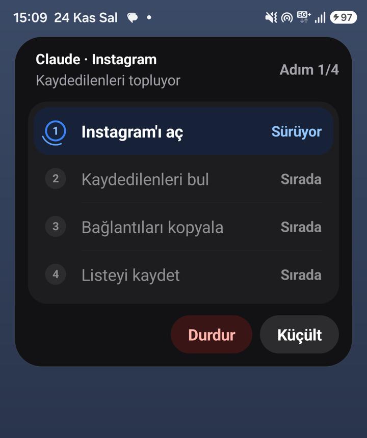
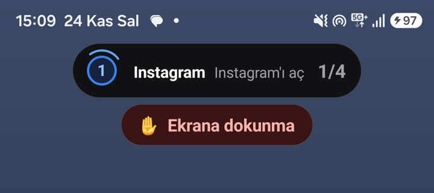
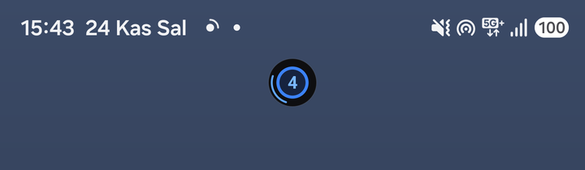
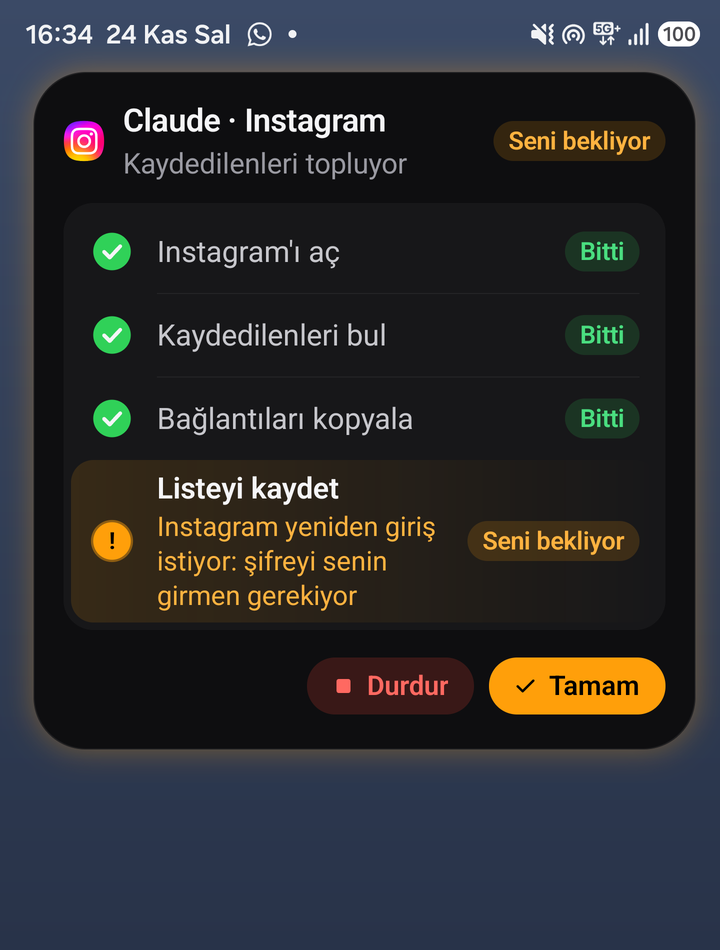
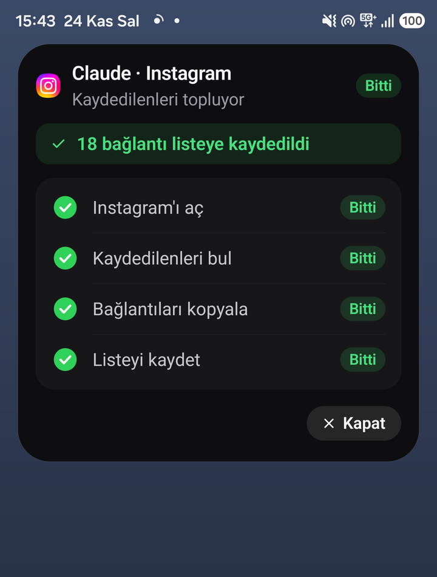
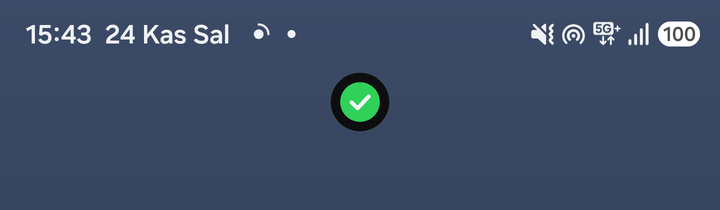

# Agent Presence for Android

While an AI agent (Claude) is operating your phone, a small card at the top of the screen shows **that** it is,
**what** it is doing, **which step** it is on, **what you must not touch**, and **when it is over**. It never leaves you
wondering whether it is still running.

The protocol and the look are shared with the Mac library: see [`../SPEC.md`](../SPEC.md).

- `:agentpresence`: the Android library (Kotlin, plain Views, no dependencies). minSdk 31.
- `:host`: a small app, **Agent Presence**, that embeds the library and takes events from a computer over adb.

## What you see

| expanded: the tasks | compact + directive capsule | minimal, under the camera |
|---|---|---|
|  |  |  |
|  |  |  |

| | |
|---|---|
| **Expanded** | for 5 s when the agent starts, intervenes, adds a directive, finishes or fails; 8 s after a tap; sticky while it needs you. `agent · app`, title, then the tasks **one under another**: status circle, task, status word (Bitti / Sürüyor / Sırada / Seni bekliyor / Olmadı). The attention or fail message sits under its task, the done message under the title. **Durdur / Küçült** (finished: **Kapat**). No directives here. |
| **Compact** | top centre: step circle, the target app's real icon, app and step, the one critical datum. The resting size while a directive is active, with the directives in a **separate capsule** under it (a red badge with a raised hand for don'ts, a green one with a check for do's); also 3 s after a step change. |
| **Minimal** | just the circle, **right under the camera hole**. The resting size of everything else, done (green check) and failed (red cross) too until tapped. A second session gets its own small circle next to it; more than that, and they get a row of their own so the card never shrinks. |

Directives are computed (SPEC "Directives on screen"): a step may say which input the agent itself drives,
`{"title":"Mesajı yaz","uses":["touch","keyboard"]}`. While any step that is not finished yet drives an input, the
capsule says so ("Ekrana dokunma", "Klavyeye ve trackpad'e dokunma", ...), plus the steps' own `dont`, the session
`dont` and `do`. A typed "don't" that only repeats a generated warning (one about the keyboard, trackpad or screen) is
dropped, so each warning is said once. Nothing is shown while the agent waits for you or once it is over.

Alerts glow in their accent (SPEC §4): the card, the pill or the circle pulses amber while the agent waits for you,
glows red when it failed and green when it is done. Nothing glows while it simply runs.

One circle tracks the whole task: an arc orbits it while the agent works; a check draws itself, then the next
number slides in when a step is finished; a ripple goes out when it is done; an amber halo pulses while it waits
for you; it shakes once on failure. Sessions driven on another device (`"device":"mac"`) carry a small laptop badge.

The look follows SPEC §4 ("premium"): a `#0E0E10` card with a hairline, status badges, a gradient on the active
task, capsule buttons with icons, and no emoji anywhere: the icons are Material Symbols Rounded paths (Apache 2.0)
as vector drawables. When the target app is installed (a launcher app whose label matches `app`, case-insensitive),
its real icon is shown; otherwise a neutral rounded square. The lookup sees only launcher activities (a `<queries>`
intent for MAIN/LAUNCHER), not every package, and is cached per name.

On Android 16+ the ongoing notification is a **Live Update** (`ProgressStyle`, one segment per step,
`requestPromotedOngoing`, short critical text) with **Durdur / Göster** actions. Attention and the end of a task also vibrate.

## From an app on the phone

```kotlin
AgentPresence.send(context, PresenceEvent(
    id = "t1", type = "start", app = "Ayarlar", title = "Wi-Fi ayarlarını kontrol ediyor",
    steps = listOf(Step("Ayarları aç", uses = setOf("touch")), Step("Wi-Fi'ı bul"), Step("Ağı seç", uses = setOf("touch"))),
))
AgentPresence.send(context, PresenceEvent(id = "t1", type = "step"))
AgentPresence.send(context, PresenceEvent(id = "t1", type = "done", message = "Bağlandı"))

AgentPresence.onStopRequested = { session -> /* the owner tapped Durdur: stop */ }
val json = AgentPresence.state()   // {"v":1,"sessions":[{"id","phase","step","total","stopRequested",...}]}
```

`AgentPresence.sendJson(context, json)` takes one event object or a JSON array of them. The app needs the
"display over other apps" permission (`Settings.ACTION_MANAGE_OVERLAY_PERMISSION`) and notification permission.

## From a computer, over adb

```sh
adb install host/build/outputs/apk/debug/host-debug.apk
adb shell appops set dev.deniz.agentpresence.host SYSTEM_ALERT_WINDOW allow
adb shell pm grant dev.deniz.agentpresence.host android.permission.POST_NOTIFICATIONS

tools/send.sh '{"v":1,"id":"t1","type":"start","app":"Spotify","steps":[{"title":"Aç","uses":["touch"]},"Bul","Ekle"]}'
tools/send.sh '{"v":1,"id":"t1","type":"step","detail":"3/10"}'
tools/send.sh '{"v":1,"id":"t1","type":"done","message":"Liste hazır"}'
tools/send.sh            # state only
```

Under the hood (SPEC §6):

```sh
adb shell am broadcast -n dev.deniz.agentpresence.host/.EventReceiver \
    -a dev.deniz.agentpresence.EVENT -f 0x20 --es b64 <base64 of the event JSON>
# Broadcast completed: result=0, data="<base64 of the state JSON>"
```

- The receiver is guarded by `android.permission.DUMP`, which only the adb shell holds: other apps on the phone
  cannot fake an agent.
- `-f 0x20` (include stopped packages) reaches the app even before it was ever opened or after a force-stop.
- Result code `1` means the event was rejected; the data then holds `{"error": "..."}`.
- The state also carries `"overlay":{"x","y","w","h"}` (pixels) so an agent can avoid tapping under the card.

## Build

```sh
./gradlew :agentpresence:testDebugUnitTest :host:assembleDebug
```

Needs a JDK 17–21 in `JAVA_HOME` (Gradle 8.13 does not run on newer ones), AGP 8.13, Kotlin 2.3,
compileSdk/targetSdk 36. Install the host with `adb install host/build/outputs/apk/debug/host-debug.apk`, then grant
the overlay: `adb shell appops set dev.deniz.agentpresence.host SYSTEM_ALERT_WINDOW allow` (or open the app once).

## Where the minimal circle sits

Right under the camera hole, centred on it (the display cutout's bounding box; top centre on a phone without one),
**just below the status bar**. Beside the hole, inside the status bar band, looks closer to an island, but an app's
overlay lies under the status bar there and One UI's status bar takes the tap: tested on a Galaxy S24 Ultra (One UI 9),
a tap on the circle in the band did nothing. `AgentPresence.minimalInStatusBar = true` puts it in the band, right of
the hole, anyway (the host app takes `--ez band true|false` on the same broadcast).

## Known limits

- Android hides app overlays on top of system Settings screens, permission dialogs and the install prompt;
  only the notification shows there.
- On One UI 9 the Live Update is accepted (`PROMOTED_ONGOING`, segmented progress, Durdur/Göster) but no status bar
  chip appeared, and the shade orders it among the other notifications. The lock-screen Now Bar was not tested.
- On a pure black app the minimal circle's dark disc disappears into the background; the coloured circle stays visible.
- Taps sent with `adb shell input tap` land on the card like a finger would.
