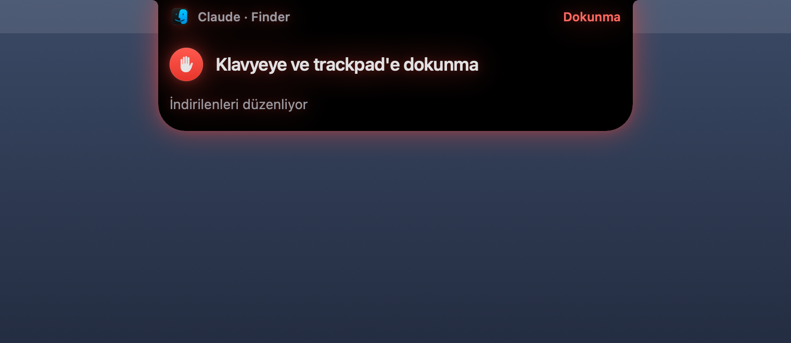
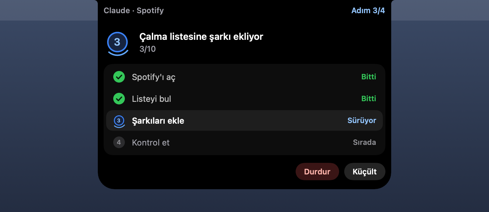
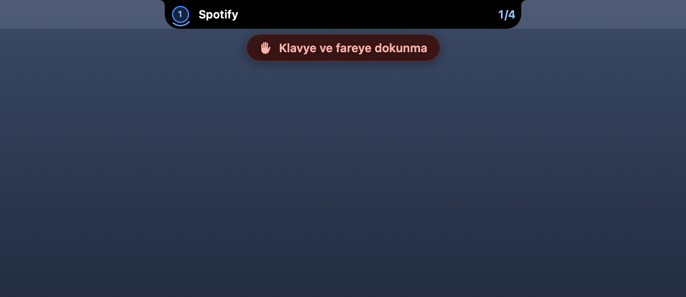

# Agent Presence for Mac

When an AI agent (Claude, or any other) drives your Mac, a small island grows out of the notch and tells you what it
is doing, which step it is on, what you must not touch, and when it is done. It never leaves you guessing whether the
work is still running.

| 1. warning first (3 s) | 2. the tasks (5 s) | 3. at rest: compact + directive capsules |
|---|---|---|
|  |  |  |

- **What to (not) do comes first.** When a task starts with something you must not touch, a warning card opens
  first; only then the task list. Without such a thing the task list opens directly.

- **One circle tracks the whole task.** It orbits while a step runs, draws a check when the step ends and slides the
  next number in. One ripple means done. An amber pulse means it needs you, and a red shake means it failed.
- **Expanded** is the task list: every task one under another with its state (Done / Running / Next /
  Needs you / Failed; in Turkish Bitti / Sürüyor / Sırada / Seni bekliyor / Olmadı), and **Stop / Minimize**
  (**Durdur / Küçült**; once done **Close**, **Kapat**). No directives here.
- **Directives only in the closed size**, in their own capsule under the island. If even one task still to come drives
  the keyboard or the mouse, the capsule says "Don't touch the keyboard or trackpad" ("Klavyeye ve trackpad'e dokunma") until that task is finished. With no such
  task, the island rests as just the circle.
- **Done stays.** After the announcement, a green check remains beside the notch until you click it away.
- Several sessions at once: the extra ones sit beside the island as small circles. A session mirrored from a phone
  carries a phone badge.
- It never takes keyboard focus, and clicks fall through everywhere except on the island. While the agent is driving
  the mouse, the 5 s announcement is click-through too. It shows on every desktop and over full-screen apps, and is
  hidden from screenshots unless `presence config capture on`.

## Install

```sh
./scripts/install.sh        # builds, installs /Applications/AgentPresence.app, links ~/.local/bin/presence
presence demo               # 35 s walkthrough of every state
```

Requires macOS 14+ and Swift 6. The app starts by itself on the first `presence` call. It has no Dock icon and no menu.

## CLI (what an agent calls)

```sh
presence start "Adding songs to a playlist" --app Spotify \
  --steps "Open Spotify [keyboard,mouse]|Find the playlist|Add the songs [keyboard,mouse]|Check"
presence step            # next step (or: presence step 3 --detail 3/10)
presence wait "Spotify wants a login: please type your password"   # needs you: stays open, plays a sound
presence resume
presence done "Added 10 songs"   # or: presence fail "why"
presence end             # remove it now
```

- `--on phone` drives an Android phone: the event goes over adb to the [Android host](../android) and is also
  shown here as progress, with a phone badge and without its "don't touch" (`--no-mirror` keeps it on the phone).
  Mac work stays on the Mac.
- **Exit code 3** means the owner pressed **Stop** (**Durdur**). The agent must stop, then send `done` or `fail`.
- `presence status`, `presence snapshot out.png` (renders the island, no screen permission needed),
  `presence send '<raw json>'`, `presence config language tr|en|auto`, `presence config sound on|off`.

## Embedding

```swift
import AgentPresenceKit
let store = PresenceStore()
let island = IslandController(store: store)
store.handle(PresenceEvent(id: "job", type: .start))  // see SPEC.md for every field
```

## Claude Code

`../integrations/install-claude-code.sh` makes Claude announce its tasks by itself and adds hooks so that screen
driving is never silent: see [`../integrations/claude-code.md`](../integrations/claude-code.md).

## Library

`AgentPresenceCore` (Foundation only) holds the protocol and the session reducer; `AgentPresenceKit` holds the views
and the panel. The event format is shared with the Android library: see [`../SPEC.md`](../SPEC.md).
